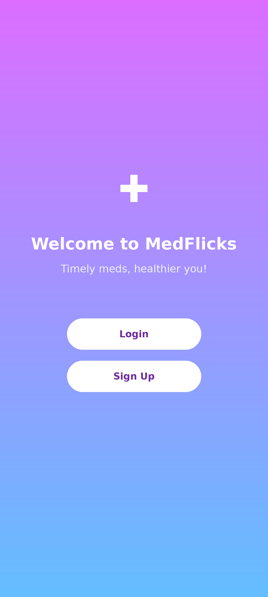
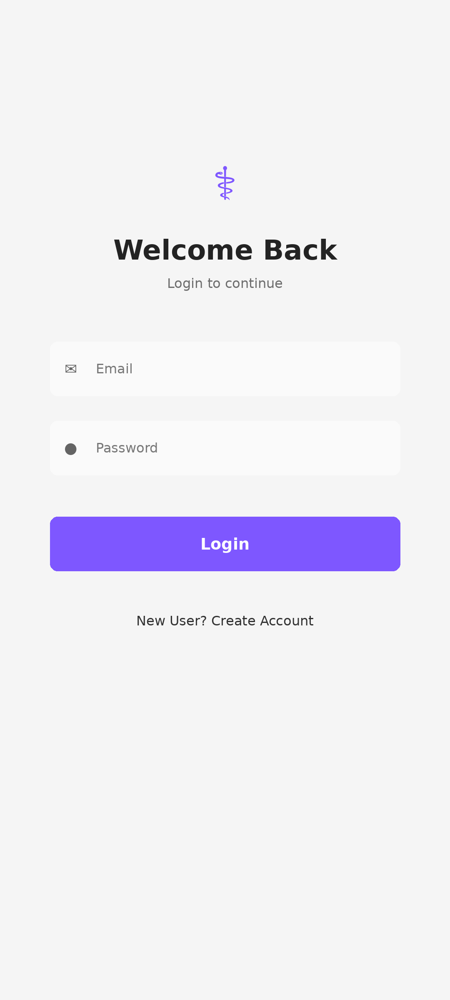
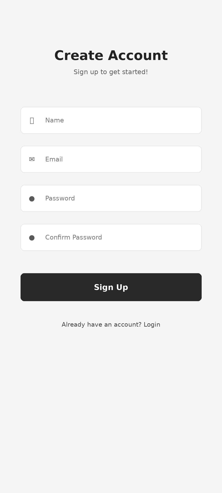
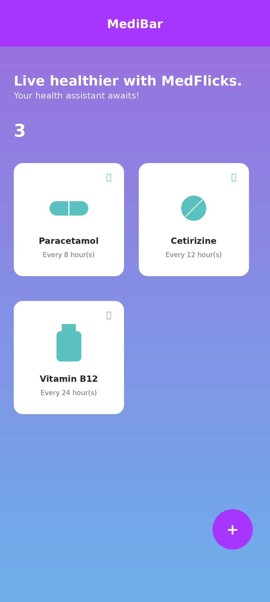
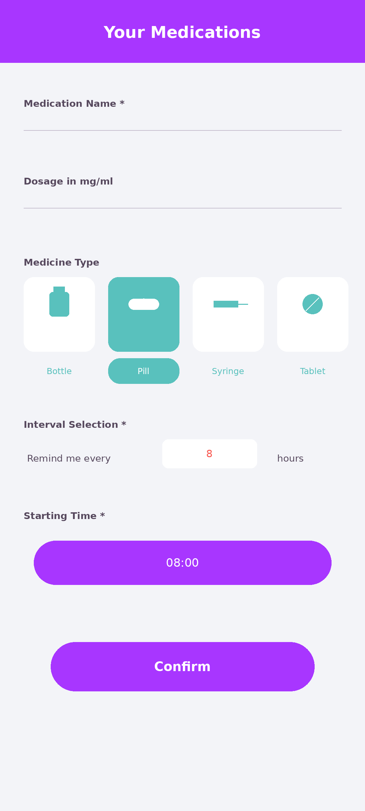
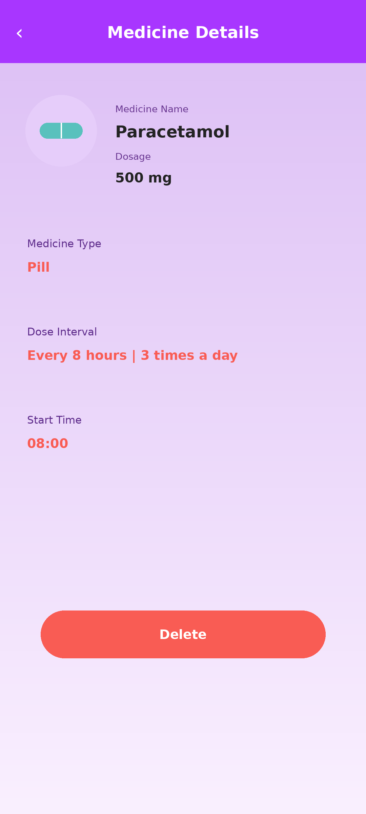
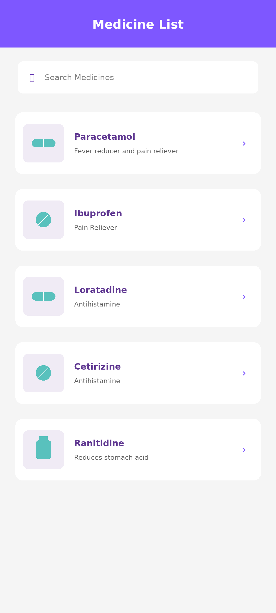
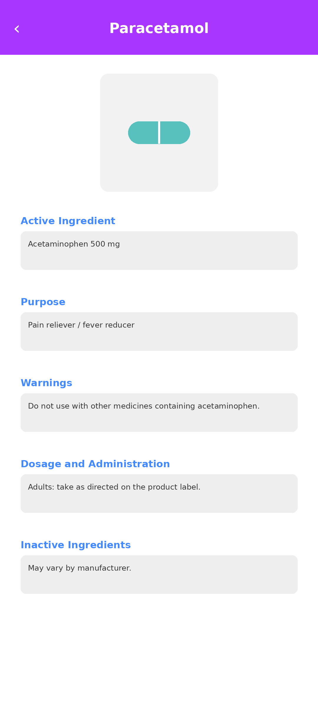
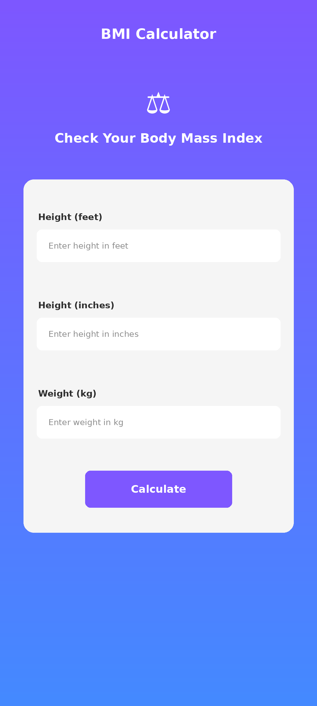
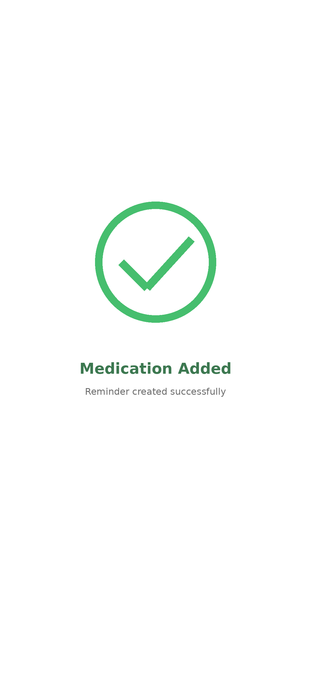

# Med Reminder

A Flutter app for organizing medicines, scheduling dose reminders, and browsing medicine information. The app includes Firebase authentication, local medicine storage, and a BMI calculator, with a purple-and-blue interface branded as MedFlicks and MediBar.

## App UI showcase

These mockups from [`mockups/`](mockups/) illustrate the app's screens and user flow. Open an image to view it at full size.

### Welcome and authentication

| Welcome | Login | Sign up |
| :---: | :---: | :---: |
|  |  |  |

### Medicine reminders

| Home dashboard | Add medicine | Reminder details |
| :---: | :---: | :---: |
|  |  |  |

### Medicine information and health tools

| Medicine browser | Medicine information |
| :---: | :---: |
|  |  |

| BMI calculator | Success confirmation |
| :---: | :---: |
|  |  |

## Features

- **Account access:** email and password signup, login, and logout through Firebase Authentication.
- **Medicine management:** save a medicine's name, dosage, type, start time, and reminder interval; view details or delete entries.
- **Dose reminders:** schedule local notifications and enable or disable reminders for individual medicines.
- **Local storage:** retain medicine entries and reminder preferences on the device using SharedPreferences.
- **Medicine browser:** search the built-in medicine list and fetch drug-label information from the openFDA API.
- **BMI calculator:** calculate body mass index from height and weight.
- **Success feedback:** show an animated confirmation after adding a medicine.

## Built with

| Area | Technology |
| --- | --- |
| App framework | Flutter and Dart |
| Authentication | Firebase Core and Firebase Auth |
| State management | Provider and RxDart |
| Local persistence | SharedPreferences |
| Reminders | Flutter Local Notifications and timezone scheduling |
| Medicine information | HTTP requests to the openFDA drug-label API |
| Interface | Sizer, Google Fonts, Flutter SVG, and Flare animations |

## Getting started

Use the [`medicine_reminder/`](medicine_reminder/) project for the commands below. Its SDK constraint is Dart `^3.9.0`; install a Flutter SDK that includes a compatible Dart version and the platform tools for your target device.

### 1. Install dependencies

From the repository root:

```bash
cd medicine_reminder
flutter pub get
```

The project uses a local override for `flare_flutter` in `patched/flare_flutter/`. Keep that directory in place when resolving dependencies.

### 2. Configure Firebase

The app initializes Firebase at startup and includes a generated `lib/firebase_options.dart`. To use your own Firebase project:

1. Register your target apps in Firebase with matching application identifiers.
2. Enable the **Email/Password** sign-in provider in Firebase Authentication.
3. Generate Firebase options using the FlutterFire CLI and add the platform configuration files required by your target apps.

Authentication and remote medicine information require an internet connection. Medicine entries are stored locally; the current storage implementation does not sync them between devices.

### 3. Run the app

Connect a device or start an emulator, then run:

```bash
flutter devices
flutter run
```

Test reminders on a real mobile device and grant the notification and alarm permissions required by its operating system. Delivery depends on platform permissions and background restrictions. The repository includes web and desktop scaffolding, but reminder support and Firebase configuration need to be checked for each target. Desktop Firebase options are currently unconfigured.

## Repository layout

```text
med-reminder/
|-- mockups/                       # UI showcase images
|-- medicine_reminder/             # App used by the setup instructions
|   |-- lib/
|   |   |-- main.dart              # App startup and theme
|   |   |-- global_bloc.dart       # Medicine state and local persistence
|   |   |-- local_notification.dart
|   |   |-- models/                # Medicine data models
|   |   `-- pages/                 # Auth, reminders, browser, and BMI screens
|   |-- assets/                    # Icons, animations, and sounds
|   |-- patched/flare_flutter/     # Local animation dependency override
|   `-- pubspec.yaml
|-- medicine_reminder_p/           # Additional Flutter project copy
`-- README.md
```
